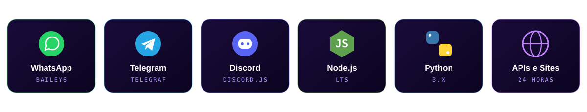

 

### *Hospedar é fácil. Hospedar **bem** é outra história.*

Seu bot responde na hora, aguenta grupo cheio, não engasga no horário de pico 
e não te deixa na mão quando você mais precisa. **Isso é Lordehost.**

## 👑 O padrão Lordehost

## ⚡ Veja na prática

Do <code>npm start</code> ao bot respondendo — em segundos.

## 🏆 Feita pra quem leva o projeto a sério

> **Bot bom em hospedagem ruim vira bot ruim.** 
> Seu código merece um lugar à altura dele.

  

<a href="https://lordehost.com.br"><b>🌐 lordehost.com.br</b></a>
&nbsp;&nbsp;•&nbsp;&nbsp;
<a href="https://wa.me/556699232131"><b>💬 Falar com o dono</b></a>

  

© 2026 Lordehost • Todos os direitos reservados

